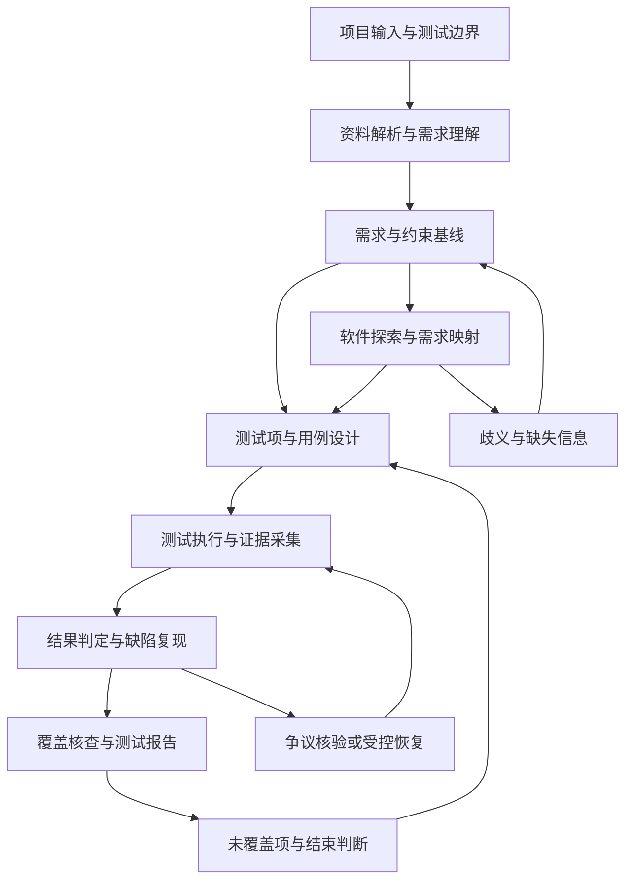

# C/S 自主测试系统：总体流程、能力框架与分阶段验证总纲

版本：v0.1 讨论稿｜日期：2026-10-22

本文定义系统做什么、各环节如何衔接、如何验证，不预先决定多 Agent 架构、服务拆分、数据库、运行框架或执行器选型。新增建议均须与用户确认的目标区分；本文不是已批准的完整实施规格。

## 1. 目标、依据与边界

### 1.1 已确认的任务目标

给定被测软件的需求资料、可运行软件及测试范围，系统应自主理解需求、探索软件、规划测试、执行操作、判断结果，交付有证据且可追溯的结论。第一阶段聚焦一个 Windows C/S 软件中的可控功能范围，优先验证黑盒能力。

“未知软件”指测试方事先没有掌握其源码、内部实现和缺陷答案；用户仍需提供必要的启动条件、账号、合法操作范围及可用资料。缺失信息应显式报告，不能自行编造。

### 1.2 原始正式要求

已读取原始《技术要求.docx》（2026-10-08 上传，8 页）。它规定四组功能：测试需求智能分析、测试用例智能设计、软件文档智能审查、测试过程控制与管理，并规定性能、部署和材料要求。

原文件没有直接规定 Windows GUI 无人自主执行。陌生软件自主测试是后续明确的目标；Windows C/S 和 MiniOrder 是阶段范围与实验载体，不能反向写成原文件条款。

测试系统要求 B/S 架构、Linux/Kylin V10 部署；被测对象目前是 Windows C/S。两者属于不同对象。若 GUI 执行需要 Windows 环境，应验证二者如何连接；具体部署拓扑尚未决定。

### 1.3 两类需求文件的角色

| 资料 | 使用方与用途 |
|---|---|
| 原始《技术要求》 | 用于评估我们建设的测试系统是否符合要求 |
| 被测软件需求规格说明、业务规则、操作资料 | 测试 Agent 据此确定被测软件应该怎样工作 |
| MiniOrder 中文需求 | 当前受控实验中的被测业务需求 |
| 契约矩阵、植入缺陷清单 | 评估方保存的真值材料；正式盲测方不可见 |

### 1.4 当前最小范围

一个软件、一个可控功能范围、明确需求、可重置数据；先验证功能与相关异常、边界测试的主闭环。多格式能力、性能/接口/安全测试、文档审查和管理功能保留在总范围清单内，其验证排期另定。

不因本总纲直接新增框架、独立服务、公共 API、多 Agent 集群或知识学习系统。多 DPI、RDP、无人值守等未自动纳入当前阶段。

## 2. 运行时业务流程

### 2.1 主流程与反馈

反馈有预算和结束条件。返回上游时保留变更原因及版本；需求变更由用户决定，Agent 不能根据程序实际行为悄悄修改预期。

“项目输入与测试边界”是运行准备，不另设一个抢在需求理解前面的能力验证阶段。

### 2.2 各环节的职责和交付

| 环节 | 关键职责 | 输出 | 失败或缺失的处理 |
|---|---|---|---|
| 项目准备 | 确认范围、资料版本、启动方式、操作限制、数据与运行预算 | 运行基线与可执行条件清单 | 区分整体阻塞和局部阻塞 |
| 资料解析 | 读取文字、表格和图示，保留版面与来源定位 | 带来源位置的解析内容 | 标记无法解析区域，不静默丢弃 |
| 需求理解 | 识别对象、原子规则、条件、约束、异常与测试类型 | 带原文依据的需求基线 | 区分明示、推导、假设和歧义 |
| 软件探索 | 发现入口、控件、状态、操作路径，并与需求对应 | 功能入口、路径与状态记录 | 找不到入口不等同于功能不存在 |
| 测试项生成 | 形成测试目标、优先级、方法、充分性和通过准则 | 测试项及需求关联 | 无明确依据的测试建议单独标记 |
| 用例设计 | 正常、异常、等价类、合法/非法边界及状态相关测试 | 输入、前置条件、步骤、预期、评估与中止条件 | 不用实际输出代替预期结果 |
| 执行与采集 | 按用例操作、观察、复观测、受控恢复 | 操作与证据、执行状态、预算消耗 | 工具失败与产品行为分别记录 |
| 判定与复现 | 对比预期和实际，核验冲突，复现疑似缺陷 | 判定、缺陷候选、复现结果及证据 | 不足时保留无法判断 |
| 覆盖与报告 | 检查未执行项、统计结果并生成可追溯报告 | 报告、缺口、限制和下一步 | 未覆盖范围不能被总体通过掩盖 |

### 2.3 探索的两种用途

第一轮探索用于了解入口和操作路径；测试执行中也会发生局部探索。需求理解阶段的独立验证不允许通过运行软件来反推需求。探索阶段新发现的功能可以形成建议或待确认项，不能自动变成正式需求。

对难以安全判断的控件，记录可见信息和不确定性；不能为了探索任意触发范围外操作。

## 3. 能力框架：逻辑职责，不等于部署组件

建议用以下逻辑职责整理仓库事实和候选方案。一个 Agent 可以承担多个职责，现有框架也可能覆盖多个职责；不要求每项都单独实现。

| 逻辑职责 | 负责什么 | 需要保持的边界 |
|---|---|---|
| 资料处理与需求分析 | 解析、规则提取、来源定位、歧义识别 | 不能把未识别区域当作没有需求 |
| 测试规划 | 测试项、用例、覆盖、优先级和补测 | 规划完成不等于实际执行 |
| 流程控制 | 组织状态、预算、重试、恢复和结束 | 不无限循环，不静默跳过用例 |
| 软件观察与执行适配 | UIA、视觉及允许的其他测试工具 | 执行器提供动作与观察，不单独承担业务正确性判断 |
| 判定与证据核验 | 对比预期、处理冲突、复现与归因 | 工具字段和模型自述不是充分的产品缺陷证据 |
| 记录与报告 | 关联需求、用例、运行、问题和证据 | 原始结果不可被事后评估覆盖 |
| 人工交互 | 需求确认、范围取舍、人工编辑与接管 | 记录人工参与，避免把辅助结果计为完全自主 |

是否需要独立 Agent、MCP、任务队列或单独服务，应在仓库盘点和阶段实测后决定。

## 4. 需要传递的信息与追溯关系

以下是输出内容要求，不预先指定 JSON Schema、数据库表或文件目录。

| 对象 | 最少应包含的信息 |
|---|---|
| 需求 | 标识、原文及位置、对象、条件、规则、类型、约束、歧义、信息性质 |
| 探索记录 | 软件版本、入口、观察到的状态、操作路径、需求映射及未知项 |
| 测试项 | 原始要求中的名称、标识、需求小节号、优先级、描述、前提约束、方法、充分性、通过准则与置信度 |
| 用例 | 关联测试项、描述、前提约束、输入、步骤、各步骤预期与评估、最终预期、中止条件与置信度 |
| 运行记录 | 版本、种子/初始状态、工具、实际动作、证据位置、执行状态、判定、失败原因和人工介入 |
| 问题 | 关联需求/用例/运行、预期与实际、证据、复现步骤、类型、严重性、归因及确认状态 |
| 报告 | 范围、环境、覆盖、结果、缺陷、未执行/无法判断项、限制与追溯索引 |

追溯主线为：需求 → 测试项 → 用例 → 运行结果 → 问题/证据。允许多对多关联；同一需求可对应多条用例，同一缺陷可有多个表现，不按表现数重复统计。

### 4.1 两种状态必须分开

执行状态至少需要区分：未执行、执行中、已完成、阻塞、中止。结果判定为 PASS、FAIL、INDETERMINATE；未执行项不能计为通过或已判定。

若工具失败导致用例无法完成，可记录“执行阻塞，结论无法判断”；不能自动记录产品失败。范围外或不适用项单独列出理由，不能用来消除遗漏。

### 4.2 历史经验的使用

原始要求允许使用历史经验补全字段，并要求突出标记。历史建议、当前需求和实际行为应保持可区分；历史补全不能冒充当前文档明示要求。自主学习和提示词自我优化尚未作为当前阶段实施要求。

## 5. 逐阶段验证路线

阶段是验收顺序，模块是系统职责；二者不能混为一谈。单模块验证和上下游连接验证都要有证据。

| 阶段 | 验证问题 | 主要输入 | 独立评估依据 | 应交付证据 |
|---|---|---|---|---|
| S1 需求理解 | 能否从文件准确识别需测试的规则及歧义 | 被测需求文件，不运行软件 | 独立人工核验的需求与规则清单 | 提取结果、来源定位、遗漏/误解/编造与解析失败清单 |
| S2 软件探索 | 能否把需求对应到陌生软件入口、路径与状态 | 核验后的需求、软件、约束 | 评估侧保存的入口与路径依据 | 探索轨迹、映射、不可达与未知项 |
| S3 测试设计 | 能否生成有效且覆盖规则的测试项与用例 | 核验后的需求和必要探索结果 | 需求规则与覆盖评审依据 | 正常/异常/边界覆盖、预期依据、设计缺口 |
| S4 测试执行 | 能否可靠完成给定测试并留下实际证据 | 人工核验用例、软件、初始数据 | 独立观察和允许的结果核验方式 | 动作、回读、恢复、状态和工具故障记录 |
| S5 结果判断 | 能否区分产品失败、工具问题及证据不足 | 预期与实际证据，必要时可复现 | 评估侧真值及独立行为核验 | 正误判、保留判断、复现和人工裁决记录 |
| S6 报告与追溯 | 能否如实汇总事实并定位遗漏 | 已核验的运行和问题记录 | 底层事实与报告逐项核对 | 统计一致性、完整追溯、遗漏和夸大检查 |
| S7 整体闭环 | 各环节连接后能否自主完成同一任务 | 原始资料、软件和运行约束 | 冻结协议及独立评估 | 完整运行、错误传播、人工介入与独立复验 |

### 5.1 每阶段统一的验证办法

1. 在运行前明确验证问题、输入权限、样本、输出、评估依据、预算、指标口径和结束条件。
2. 先用核验后的上游输入验证本环节，避免上游错误掩盖本环节能力。
3. 再用上游的真实输出验证连接，追踪信息是否丢失、误解或扩大。
4. 记录成功、失败、未执行与无法判断，不选择性保留满意结果。
5. 根据证据决定继续、最小修正或标记阻塞；不要求所有辅助环节零缺陷才允许验证下一环节。
6. 不以单个综合分替代需求覆盖、执行完成、判断准确性和人工参与情况。

正式验收门槛优先来自原始要求。原文没有定义的门槛属于建议，必须在正式实验前明确，不能事后修改来追求通过。

## 6. S1 首轮验证设计

### 6.1 范围建议

先选择一份范围清晰的被测软件需求文件，例如 MiniOrder 中文需求，验证方法可行；保留正常规则、异常规则、数值边界、条件和歧义。为检验已有样本之外的理解能力，后续应增加未参与提示修正的独立材料。

MiniOrder 需求当前是否包含足够的表格、图片、流程图，需要读取真实文件后确认。不能用纯文本样本结果宣称多模态、多格式能力通过。

测试方只读取业务需求及通用提取规范；评估方预先整理真值，不向测试方暴露遗漏答案。该阶段不让测试方运行软件、读取源码或契约矩阵。

### 6.2 评估内容

| 维度 | 如何检查 |
|---|---|
| 内容可获得性 | 哪些页面、表格、图片被成功解析，哪些失败或被省略 |
| 需求覆盖 | 真值中的原子规则有多少被正确提取，哪些遗漏 |
| 提取准确性 | 输出中有多少规则被原文支持，哪些误解或编造 |
| 约束保真 | 数值、单位、精度、条件、例外和状态是否被保持 |
| 来源准确性 | 能否回到对应原文位置，定位是否充分 |
| 歧义处理 | 是否显式提出未明确内容，而非擅自补写 |
| 信息性质 | 明示、推导和假设是否被区分，置信度是否与证据一致 |

建议分别记录查准率与查全率，并预先规定原子规则匹配、重复项和部分正确如何计算。这是度量建议，不自动替代原文的“准确率”指标。

### 6.3 与正式指标的对应

原文要求：在符合指定编制要求的需求规格说明中，功能、性能、接口需求提取识别准确率不低于 80%。验证前需明确原文适用条件及统计口径。

首个文件的验证属于方法验证，不能代表准确率指标、至少十种格式、多模态理解或全部测试类型已经通过。扩展验证应分别覆盖文字、表格、图片/流程、跨段条件及其他规定格式。

### 6.4 阶段交付

首轮至少保存：输入文件及版本、独立评估依据、测试方指令、解析与提取输出、逐项对照结果、失败分析及适用范围。是否进入下一阶段，根据这些证据作出判断。

## 7. 原始要求的完整范围登记

主闭环不等于完整产品。以下范围来自原文件，均保留；排期不在本文中自动确定。

| 要求组 | 已读取的主要内容 | 与当前主线的关系 |
|---|---|---|
| 需求智能分析 | 对象识别，多类型内容，功能/性能/接口/边界/安全规则，测试类型推荐，测试项生成与置信度，历史补全标记，提示自定义，人工增删改 | S1、S3 及交互能力；当前仅有局部实验 |
| 用例智能设计 | 正常/异常及有效/无效等价类，合法/非法上下边界，性能精度/时间，接口正常与异常报文，用例置信度、历史补全、提示自定义、人工编辑、回归推荐 | S3；当前主样本未验证全部测试类型 |
| 文档智能审查 | 按 GJB438C 检查格式，上下文和文档间一致性、完整性；涉及规定的六类软件文档 | 独立支撑能力，可向需求理解反馈问题 |
| 过程管理 | 任务/需求/用例/执行管理，问题编辑、类型和严重性，历史缺陷匹配，状态跟踪、轮次及总体统计，自定义表单和模板、自动报告 | 贯穿主流程，S6 集中核验 |
| 知识与问答 | 历史项目知识提取、缺陷库及当前/历史资料问答 | 支撑能力；首轮可在无历史资料时验证主流程 |
| 权限与数据 | 角色权限、项目数据与知识隔离、工具管理及工具组、完整追溯、定时备份、导入导出 | 贯穿能力，不能被实验会话隔离代替 |
| 格式与导出 | 语义提取不少于十种格式，至少 docx/xlsx/csv/ppt/pptx/PDF/Markdown/png/jpg/bmp；至少导出 docx/wps/pdf | 单独准备格式与导出验证集 |
| 准确率与速度 | 指定条件下提取准确率不低于80%；A100 80GB、512GB内存条件下测试项平均不少于5个/十分钟、用例不少于1个/分钟 | 单独定义口径与性能实验，不能用当前实验代替 |
| 并发与部署 | 至少30在线用户；B/S；Linux/Kylin V10；脱离大模型时仍能便携式实现过程管理 | 产品验收范围；当前无完成证据 |
| 关键条款材料 | 原文件带星条款需提供相应技术支持材料 | 随验收整理；当前实验不能自动替代全部材料 |

原文性能用例对不确定数值要求五组以上实测值，并按需选择统计方法；边界用例要求上下边界内值、阈值、外值。实施时应回到原文完整条款核对，不能只依据本摘要。

## 8. 软件能力验证与评估系统分开

正式测试方可以看到需求、匿名程序、工具规范和运行约束。评估方保存源码、契约矩阵、缺陷清单和真值结果。

评估方可以用内部数据或源码确认缺陷归属，但若正式测试方范围是 GUI 黑盒，就不能将这些手段计为其自主能力。评估方介入要单独计数。

过程报告可在揭示真值前锁定；后续裁决新增记录，不回写为测试方原始判断。修正规则后应使用新的独立测试上下文，保留规则变化，避免提示泄漏或训练于答案。

## 9. 已有工作如何放入框架

状态来源：用户回传的 Codex 完成摘要，尚未在本会话读取 Windows 仓库原始实验文件。

| 工作 | 已报告结果 | 在本框架中的意义与限制 |
|---|---|---|
| MiniOrder MVP | 三版本、需求、重置、持久化及隔离验证完成 | 提供受控软件与评估真值；不等于测试系统本身完成 |
| round-01 | 三目标完成，检出2/2，产品误报1 | 主闭环可运行的局部证据；误报由评估方纠正 |
| round-02 | 三目标完成，检出1/2，误报0，40/52可判断，12/52无法判断 | 归因改善，覆盖和检出尚不稳定 |
| 焦点核验 | round-02冲突核验2/2，归属裁决无需评估方介入 | S5 有针对性的正向证据，不能泛化为所有工具异常已解决 |
| 工具通道 | node_repl + @oai/sky 的 UIA 入口已恢复 | S4 局部执行能力；截图通道仍未通过 |
| 第三轮 | 仅已整理任务指令，尚无完成回传 | 不计为已执行或已验证 |
| 独立需求理解评估 | 尚无专门验收证据 | 应从S1建立独立评估基线 |
| 独立产品运行框架 | 未读取仓库，尚无法确认 | Codex会话成功不等于已证明独立部署闭环 |

过去的三版本实验不作废，也不应改写成新的阶段全部通过。把原始证据映射到各阶段，指出证据缺口即可。

## 10. 现有框架与仓库事实的评估方法

先确定真实任务和成功标准，再比较已有项目能覆盖哪些职责。不能因为框架功能丰富而扩大需求，也不能因当前用了某个工具就固化为长期架构。

候选方案评价表应包含：目标平台、是否能从需求生成测试、陌生软件探索、执行工具、预期与判定、证据追溯、运行方式、部署与依赖、许可证和最小接入代价。

上一轮调研已识别 UFO、Midscene、AskUI 等候选，但没有在当前环境实测，也未完成对全部候选的充分比较。它们的版本与能力需在选型时重新核实。本文不据此指定实现栈，不要求把多个框架同时集成。

Codex 应先读仓库，提供真实的依赖和调用链：哪些已自动运行，哪些由会话指令组织，哪些人工参与，哪些尚未实现。再选择可复用方案或最小补足方案。

## 11. 当前建议的推进顺序与待决策项

### 11.1 推进顺序建议

1. 评审本总纲，确认目标、主流程和原始范围没有遗漏或扩大。
2. 由Codex核对仓库事实，将已有实现与证据映射到本文，不先建设新模块。
3. 制定并运行S1需求理解首轮实验，先验证文件解析与规则理解。
4. 根据S1结论，分别开展S2—S6的独立验证和连接验证，复用MiniOrder已有资产。
5. S7检查完整闭环，按证据决定进入真实软件验证或针对关键缺口修正。

已发出的第三轮指令应结合本总纲检查目的和依赖，不默认取消，也不默认立即续跑。若已经执行，保留结果并映射；若未执行，先确认它是否仍是当前最小必要工作。

### 11.2 需要明确但尚未替用户决定的事项

- 首轮S1使用哪个真实需求文件，是否以MiniOrder需求作为预演材料。
- 各阶段正式样本、预算与原文未规定的验收门槛。
- 首期产品范围与完整原始技术要求的交付批次。
- 当前框架复用、运行位置及测试系统与Windows执行环境的连接方式。
- 哪些歧义允许Agent继续执行不受影响部分，哪些必须等待用户确认。

这些事项应通过材料核实和小实验逐步收敛，不在本文中升级为硬性代码约束。

## 12. 总纲的使用规则

用户决定目标、范围、优先级与重大取舍；ChatGPT维护目标对齐和系统级分析；Codex读取真实仓库，选择最小实现，修改与验证。

后续每项任务都要说明：对应本总纲哪一环、解决什么缺口、输入与输出、验收依据、已有事实与未确认假设。新发现的框架能力或既有实现不能自动成为用户需求。

本文经用户确认后才作为工作总纲；具体技术实现和未决门槛仍需据仓库与实验确定。
