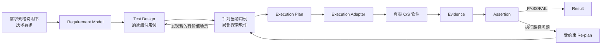
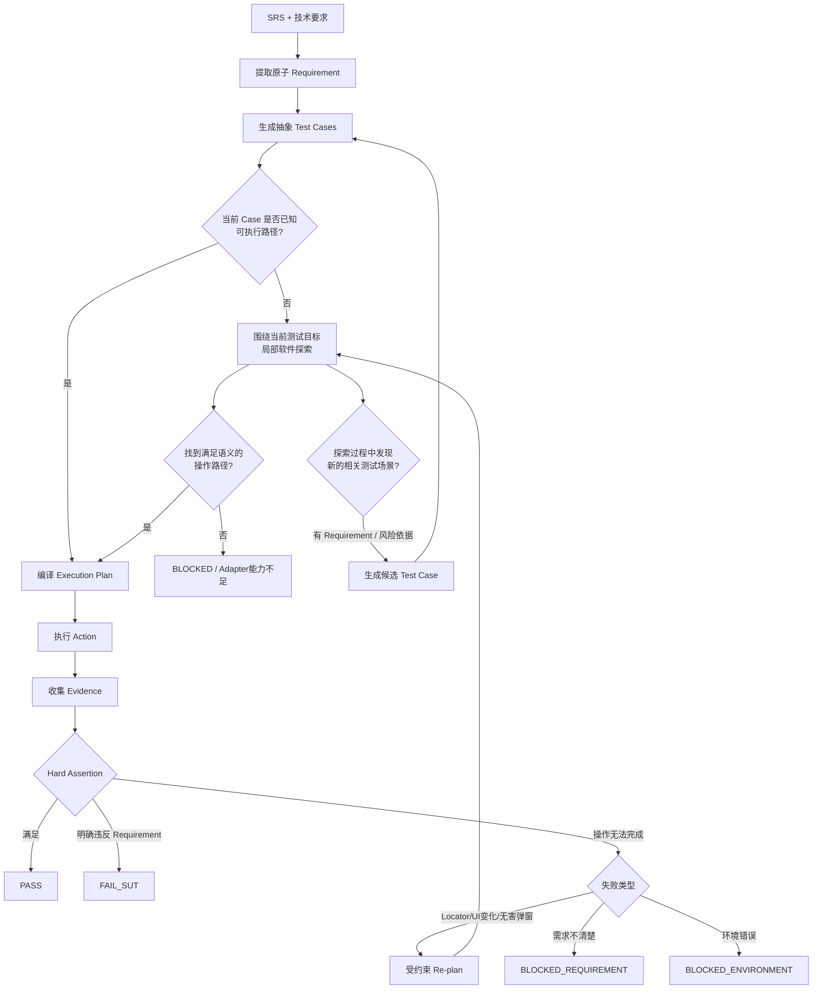
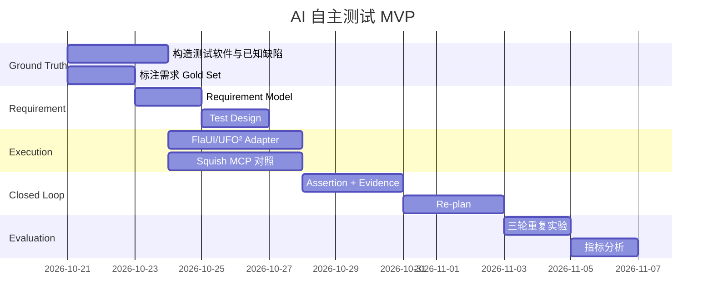

# 仅有需求文档、技术要求与被测 C/S 软件时的 AI 自主测试方案研究

## 执行摘要

本报告的核心结论是：

> **在没有历史知识库、没有人工测试脚本、也不知道被测 C/S 软件技术栈的情况下，可以让 AI 自动规划测试并指导执行器执行，但不能把任务简化成“需求文档 → LLM → 鼠标点击”。**
>
> 当前更可行的路线是：**需求先形成测试依据，AI 再围绕测试目标对真实软件进行局部探索，将抽象测试用例落成可执行路径；执行期间允许受约束的动态 Re-plan，但绝不能让软件当前行为反过来修改需求预期。**

这实际上是**预先规划型 + 动态探索型的混合测试模式**。



这与当前一些领先方案的方向是一致的：Playwright 已正式提供 `planner → generator → healer` 测试智能体流程；aidlc-testagent 采用 `explore → plan → generate → execute → heal`；Squish MCP 允许智能体直接探索正在运行的桌面应用；TESTAR 长期采用运行时 GUI 状态探索与状态模型；UFO² 则针对 Windows 使用 UIA、视觉、Win32/WinCOM 和动态规划进行桌面操作。citeturn17view1turn17view2turn16search0turn13search2turn13search0

但目前**没有证据表明上述任意一个框架，可以直接完整实现“任意需求文档 + 任意 C/S 软件 → 高质量测试设计 → 稳定执行 → 正确缺陷判定”**。例如 UFO² 在 Windows Agent Arena 上使用 o1 的任务成功率为 30.5%，OSWorld-W 为 32.7%；这已经是较强的 Windows Agent，但离“可靠测试执行器”仍有明显距离。更直接针对自主缺陷发现的 GUITester，在 143 个测试任务、26 个缺陷的 GUITestBench 上 Pass@3 F1 为 48.90%，虽然明显高于论文比较的最佳基线 33.35%，仍说明自主 GUI 测试远未达到可以完全放任 Agent 判断一切的程度。citeturn17view0turn16search3

因此，本项目最重要的技术原则应是：

**AI 负责理解、测试设计、探索和规划；可确定的执行与断言尽可能由工具完成；AI 的动态调整只能改变“怎么到达测试目标”，不能改变“什么结果才算正确”。**

同时需要明确：**本轮研究没有拿到项目原始《技术要求》全文。** 因而下面将用户本次明确提出的输入和目标视为已确认需求；文中给出的具体验收阈值属于工程建议，而不是已经确认的项目指标。后续应再拿正式技术要求逐条建立 Requirement Traceability Matrix，避免研究结论反过来定义需求。

## 输入边界与必须具备的能力

### 当前已经确定与尚未确定的条件

| 项目 | 当前状态 | 对设计的影响 |
|---|---|---|
| 软件需求规格说明书 | **确定存在** | 应成为业务预期与 Test Oracle 的主要来源 |
| 技术要求 | **确定存在** | 决定测试范围、测试类型和项目最终验收 |
| 被测软件 | **确定为 C/S 类软件** | 需要真实 GUI/进程环境 |
| 历史用例/缺陷库 | **没有** | 第一阶段不能依赖历史经验学习 |
| 需求文档格式 | **待确认** | 可能是 DOCX/PDF/XLSX/HTML/扫描件 |
| 操作系统 | **待确认** | UFO²/FlaUI 主要针对 Windows，不能默认所有项目适用 |
| GUI 技术栈 | **待确认** | 可能是 Qt、WPF、WinForms、MFC、Java、Electron、自绘控件等 |
| 是否能访问源码 | **当前按不能访问处理** | 采用真正黑盒测试模型 |
| 是否存在数据库/API | **待确认** | 如果存在，会显著提升断言确定性 |
| 测试账号/初始数据 | **待确认** | 应作为环境输入，不应让 Agent 猜测 |
| 是否允许删除/修改业务数据 | **待确认** | 必须通过执行安全策略限制 |
| 是否要求完全无人值守 | **目标倾向如此，但需由正式要求确认** | 决定低置信度场景是否允许 BLOCKED |

对于未知 Windows 软件，UI Automation 可以为测试工具提供 UI 元素树、属性和控制模式，并支持自动测试；但 Microsoft 明确指出，自定义控件或没有完整 UIA Provider 的控件可能对 UIA 基本不透明。因此，**“不知道技术栈”直接意味着执行层不能只依赖 UIA，也不能只依赖截图，应准备结构化 UI + 视觉两条感知路径。** citeturn14search0turn14search3turn14search11

### 从目标反推出来的必要能力

这里不是先确定框架，而是从“AI 自主完成测试”倒推系统必须能做什么。

| 能力 | 必须解决的问题 | 建议 MVP 验收指标 |
|---|---|---|
| **需求理解** | 哪些句子是真正可测试需求、约束、前置条件、结果 | 对人工 Gold Set 的原子需求 Precision/Recall/F1 ≥ 95%；`shall/必须/应`类关键要求不得遗漏 |
| **Requirement Model** | 把自然语言变成机器可消费测试依据 | Schema 合法率 100%；每条 Requirement 保留原文出处；歧义不得偷偷补全 |
| **软件侦察** | 当前软件是什么页面、有哪些可操作对象、怎样到达目标功能 | 目标功能可达率 ≥ 90%；关键控件发现 Recall ≥ 95%（在 MVP 标注集上） |
| **Test Design Agent** | 根据规则生成正常、异常、边界、状态转换等测试 | 可测试需求覆盖率 100%；高风险规则至少包含正向+反向/边界验证 |
| **Test Planner / Action Compiler** | 把“验证什么”转换成“这个版本软件怎么操作” | ≥95% 计划可编译；所有动作有明确目标和前置条件 |
| **Execution Adapter** | 点击、输入、菜单、窗口、弹窗、滚动等 | 基准流程连续运行 3 次，完整执行成功率建议 ≥95%；单动作成功率 ≥98% |
| **Assertion Engine** | 软件实际上是否满足需求 | 关键需求 **100% 禁止仅靠 LLM 主观判断 PASS**；已植入明确缺陷不得 False PASS |
| **Evidence Collector** | 为什么 PASS/FAIL | FAIL/BLOCKED 100% 有截图、状态信息、动作轨迹、断言实际值 |
| **Re-plan** | 找不到控件、页面变化、意外弹窗时怎样继续 | 可恢复型执行故障恢复率建议 ≥70%；修改测试预期次数必须为 0 |
| **可追溯性** | 这个 FAIL 来自哪条需求、哪条测试、哪些证据 | `Source → Requirement → Case → Plan → Evidence → Result` 完整率 100% |

这里最关键的指标不是“Agent 完成了多少点击”，而是至少同时测四件事：

\[
需求识别准确率,\quad 测试覆盖率,\quad 执行成功率,\quad 缺陷判定准确率
\]

不能拿其中一个代替其他指标。UFO² 的公开 Benchmark 本身也是通过独立的验证脚本确定任务是否真的完成，而不是直接相信 Agent 自己宣称完成。citeturn17view0

### 断言必须分级

这是整个系统能否真的称为“自动化测试”，而不是“AI 自动操作软件”的分界线。

| 等级 | 示例 | 能否作为关键需求最终 Oracle |
|---|---|---|
| **硬断言** | UIA 属性、文本值、表格行数、API 返回值、数据库值、文件、日志、进程状态、精确时间 | **是，优先** |
| **半确定性断言** | 截图区域、OCR、位置、颜色、视觉差异阈值 | 可以，但必须保留阈值和证据 |
| **LLM 语义判断** | “页面看起来进入主页”“提示大致符合要求” | 只建议用于候选异常和辅助判断，不应单独批准高风险 PASS |

GUITester 的研究尤其说明了这里的问题：一个 GUI Agent 如果只追求“完成用户任务”，可能会把真实软件缺陷误认为自己的点击/导航失败；反过来也可能把自己的执行错误误认为产品缺陷。它因此专门把 Planning-Execution 与缺陷验证/反思拆开。citeturn16search3

这正好说明我们的结果状态最好不要只有 PASS/FAIL，而应至少区分：

```text
PASS
FAIL_SUT                 # 被测软件违反需求
ERROR_EXECUTOR           # 自动化执行失败
BLOCKED_ENVIRONMENT      # 环境阻断
BLOCKED_REQUIREMENT      # 需求无法确定预期
INCONCLUSIVE_FLAKY       # 重复执行结果不一致
```

## 未知软件下的预先规划、动态探索与混合策略

### 两种方式本质上的区别

| 对比项 | 预先规划型 | 动态探索型 |
|---|---|---|
| 核心流程 | 文档 → 完整用例 → 软件执行 | 软件状态 → 操作 → 新状态 → 动态选择下一步 |
| 需求覆盖 | **强** | 容易偏离 |
| 对陌生软件适应 | 较弱 | **强** |
| 用例可审计性 | **强** | 较弱 |
| GUI 变化适应 | 弱 | **强** |
| 找到隐藏操作路径 | 弱 | **强** |
| 主动发现文档未显式枚举的场景 | 有限 | **更强** |
| Expected Result 的稳定性 | **强** | 有从当前实现反推“正确行为”的风险 |
| 可重复性 | 较高 | 较低 |
| 适合本项目单独使用？ | **否** | **否** |

TESTAR 就代表了动态探索思路：它记录 GUI 中的 State、Widget、Action 和关系，形成 GUI State Model，并可以在运行期间选择下一步动作，而不是依赖一套预录脚本。其近年的实现还增加了 LLM Action Selection、LLM Oracle 和状态模型完成条件。citeturn13search2turn13search6

另一方面，Playwright Test Agents 更接近“需求/任务先形成 Plan，再执行并 Heal”：Planner 可以接收 PRD，实际探索应用后生成精确的 Markdown 测试计划；Generator 再实时验证 selector 和 assertion；Healer 对失败进行修复。citeturn17view1

**我们需要的是两者结合，而不是二选一。**

### 推荐的混合流程



这里“探索”不是：

> 先让 Agent 把软件从头到尾乱点一遍。

而是：

> **现在我要验证 REQ-DEVICE-013，因此只探索怎样进入设备管理、怎样新增设备、怎样找到设备名称、怎样保存和观察结果。**

这叫**Requirement-scoped exploration**。它比完整预探索更节约 token 和时间，也减少破坏性操作。

### Re-plan 的边界必须固定

| 运行时情况 | 允许做什么 | 不允许做什么 |
|---|---|---|
| “新增设备”按钮改了位置 | 重新定位 | 修改测试预期 |
| “新增设备”改名为“新建设备” | 通过语义+上下文重新绑定 | 因为按钮没找到就删除该测试 |
| 页面加载慢 | 增加合理 Wait / Retry | 无限重试直到“通过” |
| 出现系统更新提示 | 关闭已知无关弹窗 | 关闭业务错误提示然后继续 |
| 测试数据导致需求规定的错误提示 | 判定需求符合/不符合 | 更换数据让用例通过 |
| 保存后实际行为违反 Requirement | FAIL_SUT | “Heal”测试让它适配错误实现 |
| 文档根本没写正确结果 | BLOCKED_REQUIREMENT | 根据软件当前行为猜正确答案 |

这点值得特别吸收 `aidlc-testagent` 的设计：其 README 明确规定，人类意图和 Requirements/Manual Tests/Business Rules 的优先级高于当前实现；如果需求和实现不一致，应该作为发现项暴露，而不是让生成器悄悄绕过。它的流程也是 `explore → plan → generate → execute → heal`。不过其当前 Phase 1 执行 Adapter 只有 Playwright Web 和 Electron，因此**理念高度匹配，但还不能直接视为普通 C/S 软件解决方案。** citeturn17view2

## 候选技术与框架的事实验证

评分只表示对**当前目标**的适配证据，并非评价项目本身好坏：

**0 = 没有直接能力；1 = 间接/需大量扩展；2 = 可使用但存在明显缺口；3 = 有直接实现证据。**

| 技术 | 需求理解 | 自主探索 | 用例/计划 | C/S 执行 | 断言/证据 | Re-plan | 当前定位 |
|---|---:|---:|---:|---:|---:|---:|---|
| **TESTAR** | 0 | **3** | 2 | 2 | 2 | 2 | 探索测试/状态模型参考 |
| **UFO²** | 1 | **3** | 2 | **3¹** | 1 | **3** | Windows 智能执行/局部探索核心候选 |
| **Squish + Squish MCP** | 1 | **3** | 2 | **3** | **3** | 2 | 跨技术栈 C/S 最值得实测的商业候选 |
| **aidlc-testagent** | **3** | 2 | **3** | 1² | 2 | **3** | 端到端 Agent 流程参考 |
| **Playwright Test Agents** | 2 | **3** | **3** | 1³ | **3** | **3** | Web/Electron 场景强候选 |
| **FlaUI** | 0 | 2 | 0 | **3¹** | 2 | 0 | Windows 确定性执行 Adapter |
| **Robot Framework** | 0 | 0 | 0 | 1 | **3** | 1 | Runner/日志/报告层 |
| **GraphWalker** | 0 | 0 | **3** | 0 | 1 | 1 | 状态模型形成后的路径生成 |
| **Hermes Agent** | 1 | 1 | 1 | 0 | 0 | 2 | 后续 Memory/Skill，不是当前测试核心 |
| **GUITester** | 1 | **3** | **3** | 0⁴ | 2 | **3** | 自主缺陷发现研究参考 |

¹ Windows。  
² 当前公开 Phase 1 主要是 Web + Electron。  
³ Playwright 的 Electron 支持官方仍标为 experimental。  
⁴ GUITester 论文实验对象并非普通 Windows C/S，因此不能直接当执行框架。

### TESTAR

TESTAR 的直接价值是**自主探索和状态模型**。官方仓库显示，它将检测到的 Widget、Action、State 及关系存入图数据库形成 GUI State Model；近年的 CHANGELOG 已出现基于 LLM 的 action selection、oracle 和基于 State Model metric 的结束条件。citeturn13search2turn13search6

它适合解决：

> “没有脚本时怎样探索软件、怎样避免永远重复同一路径、怎样知道哪些状态已经访问过？”

但它不是现成的“中文 SRS → 业务级测试用例”引擎，因此建议把 TESTAR 的 **State/Action Graph + exploration policy** 思想吸收到我们的探索模块，而不是直接把整个项目建立在 TESTAR 之上。

### UFO²

UFO² 是目前与 Windows C/S 智能执行最直接相关的开源候选之一。Microsoft 官方项目使用 Windows UIA、Win32、WinCOM、视觉检测与 GUI/API 混合操作；论文还显示 hybrid UIA+vision 能找到 UIA 单独遗漏的非标准控件，并有执行历史/外部文档增强。citeturn13search0turn17view0

但必须看实际结果，而不是 README 宣传。UFO² 论文在 WAA 的 154 个任务/15 款 Windows 软件上：

| Agent | WAA | OSWorld-W |
|---|---:|---:|
| Operator | 20.8% | 14.3% |
| UFO²-base / GPT-4o | 23.4% | 16.3% |
| UFO² / GPT-4o | 27.9% | 28.6% |
| UFO² / o1 | **30.5%** | **32.7%** |

这些成绩说明它值得验证，但同时说明**当前 GUI Agent 不应同时承担最终测试 Oracle。** citeturn17view0

### Squish MCP

这是此次研究里值得新增到重点候选名单的技术。

Squish 本身是成熟的 GUI 自动化产品，官方支持 Qt、Java、Windows/.NET、Web、移动和 Embedded；Windows 版本覆盖 MFC、WinForms、WPF，并可通过 MSAA/UI Automation 工作。citeturn16search1turn16search5turn16search18

2026 年发布的 Squish MCP 0.2 更值得关注：Qt 官方明确表示 AI Agent 可以查询当前运行应用的局部状态并直接控制 GUI，从而自主探索，而不是一次读取整个巨大的 object snapshot。官方在自己的 Qt Creator 测试生成实验中报告平均测试生成时间下降 52%、token 使用下降 41%；这属于**厂商自身实验数据，必须由我们的 SUT 独立复测，不能直接当作项目验收证据。** citeturn16search0turn16search4

因此目前很值得做一次：

> **Squish MCP vs UFO² + FlaUI**

同一 SUT、同一 Requirement、同一 Test Case Set 的 A/B 实验。

### aidlc-testagent

它最值得借鉴的不是当前 Driver，而是整个过程模型：

```text
requirements
     ↓
explore
     ↓
plan
     ↓
generate
     ↓
execute
     ↓
stability gate
     ↓
heal
```

而且它显式把 Adapter 与 Core Agent 解耦。citeturn17view2

这和我们需要的方向非常接近。不过当前公开 Phase 1 明确是 `playwright-web` 与 `playwright-electron`，traceability report 等仍在后续 Roadmap，因此目前更适合作为**架构源码参考**，不能根据项目介绍直接判定满足普通 C/S 技术要求。citeturn17view2

### FlaUI 与 Microsoft UIA

FlaUI 是 .NET 的 Windows GUI 自动化 Library，覆盖 Win32、WinForms、WPF、Store Apps，本质上封装 Microsoft UI Automation。citeturn18search0

它没有 AI，也不会自主生成用例，这反而是它的优点之一：

> **Agent 决定做什么；FlaUI 做确定性的 UI 操作和状态读取。**

对于标准 Windows 控件，这类 Driver 非常适合作为 Execution Adapter。但 Microsoft 文档明确说明，不具备合适 Provider/Proxy 的自定义控件可能对 UIA 高度不透明，所以它不能成为未知技术栈下的唯一执行方式。citeturn14search9turn14search11

### Playwright Test Agents

Playwright 现在已经正式实现了一个与本项目非常相似的流程：

```text
Planner   → 探索应用 + PRD → 测试计划
Generator → 测试计划 → 可执行测试
Healer    → 执行失败 → 检查 UI → 修复测试
```

Planner 可以接收 PRD；Generator 在真实页面中实时验证 selector 和 assertion。citeturn17view1

因此非常值得研究它的 Agent Prompt、Plan 格式和 Healer 边界。但它本质还是 Web 测试体系，Electron 也仍由官方标为 experimental，所以不适合作为未知 Native C/S 的默认 Execution Adapter。citeturn15search1

### GraphWalker、Robot Framework 与 Hermes

GraphWalker 是模型驱动测试工具：状态是 Vertex，转换是 Edge，再根据算法和停止条件自动生成测试路径；当前 Rust 实现还提供 guard、requirements tracking、weighted edge 等能力。citeturn15search3turn15search5

这意味着它更适合：

> **我们已经从探索得到 Software State Model 后，帮我们系统性补路径覆盖。**

而不是第一步就用它探索未知 GUI。

Robot Framework 是通用自动化测试/RPA 框架，可以通过 Library 扩展，执行后提供 `output.xml`、`log.html`、`report.html`、`xunit.xml` 等结构化结果。它适合作为 Test Runner 或报告层，而不是 Test Design Agent。citeturn18search1turn14search4

Hermes 当前优势是 Memory、Skill 自动创建和跨 Session recall；官方确实实现了 agent-curated memory、skill creation/self-improvement 和 session search。citeturn17view3turn15search6

因此对**未来历史经验学习**有价值，但在当前“没有历史知识库，先把第一次测试跑通”的目标下，优先级明显低于 Requirement Planning、Reconnaissance、Execution 和 Assertion。

### 当前技术选型判断

目前不建议直接确定“主框架”。建议实际进入 MVP 的组合是：

| 方案 | 用途 |
|---|---|
| **自有 Requirement/Test Planning Core** | 保证需求、测试用例、预期和追溯链由我们控制 |
| **UFO² + FlaUI** | 开源 Windows 智能探索 + 确定性执行基线 |
| **Squish MCP** | 与上面做同场 A/B，验证跨技术栈和 Autonomous GUI Testing 的实际价值 |
| **TESTAR** | 研究和借用状态图/探索策略，不先作为主流程 |
| **Robot Framework** | 是否作为执行编排/报告层通过实验决定 |
| **Playwright Agent** | Electron/WebView SUT 时优先考虑 |
| **GraphWalker** | Software State Model 已形成后再评估 |
| **Hermes** | 历史经验阶段再引入 |

也就是说，**先按能力做实验，再选框架，而不是先定框架再修改需求来适应它。**

## 最小可行验证实验

### 为什么 MVP 不应该直接找大型生产软件

第一次实验的目的不是证明“AI 能点软件”，而是回答几个非常具体的问题：

> 文档能不能准确转成 Test Case？  
> Test Case 能不能在一个从未见过的软件上自动找到执行路径？  
> 软件真的违反 Requirement 时，Agent 能不能发现？  
> 执行失败和产品缺陷能不能区分？  
> Re-plan 会不会偷偷把失败 Heal 成通过？

因此建议第一阶段采用一个**可控的 C/S 测试靶场**。

### 推荐实验软件

建议构造一个小型：

**DeviceManager Client**

```text
Windows WPF Client
       │
       ├── Login
       ├── Device Query
       ├── Add Device
       ├── Edit Device
       └── Delete Device
               │
               ▼
        Local Mock REST Service
               │
               ▼
            SQLite
```

选择 WPF 不是认为正式系统一定是 WPF，而是 MVP 必须有一套**我们知道 Ground Truth、可以植入已知缺陷、可以重复恢复环境**的软件。

然后第二轮再换成 Qt 或真实项目软件，验证技术栈变化是否导致方案崩溃。

### 示例 Requirement Set

准备约 15～30 条原子需求，例如：

| ID | Requirement |
|---|---|
| REQ-LOGIN-01 | 正确用户名和密码应进入主页 |
| REQ-LOGIN-02 | 错误密码应提示“用户名或密码错误” |
| REQ-LOGIN-03 | 连续三次密码错误应锁定账户 |
| REQ-DEV-01 | 设备名称长度为 1～20 个字符 |
| REQ-DEV-02 | 设备名称为空时禁止保存 |
| REQ-DEV-03 | 超过 20 字符时禁止保存并提示 |
| REQ-QUERY-01 | 输入存在的设备编号应返回该设备 |
| REQ-QUERY-02 | 不存在编号应显示空结果 |
| REQ-DELETE-01 | 删除设备前必须二次确认 |
| TR-PERF-01 | 设备查询结果应在规定时限内返回 |

刻意在 SUT 中植入 5～8 个已知缺陷，例如：

```text
Bug A：允许保存 21 字符设备名
Bug B：错误密码两次就锁定
Bug C：删除没有确认框
Bug D：空编号查询发生异常
Bug E：某按钮 AutomationId 缺失
Bug F：首次加载偶发弹窗
```

其中 E、F **不是产品缺陷，而是专门测试执行器和 Re-plan**。

### 可复现流程



| 实验步骤 | 输入 | 操作 | 产出 |
|---|---|---|---|
| 文档解析 | SRS + 技术要求 | 不给软件信息 | Requirement Model |
| 用例设计 | Requirement Model | AI 自主设计 | Abstract Test Cases |
| 软件 Probe | EXE | 检查 UIA/Object Tree/Screenshot | Capability Profile |
| 局部探索 | Test Case + SUT | 寻找对应业务路径 | State/Control observations |
| Plan | Case + observations | 绑定操作目标 | Execution Plan |
| Execute | Execution Plan | 执行 GUI | Action Trace |
| Assert | Evidence + Requirement | Hard/Semi-hard Oracle | PASS/FAIL/BLOCKED |
| Re-plan | 执行错误 | 最多 N 次恢复 | 新 Plan / ERROR |
| Repeat | Clean VM | 同一实验 3 次 | 稳定性数据 |
| Evaluate | Gold Set + seeded defects | 自动统计 | Scorecard |

### 最关键的评价指标

假设 Gold Set 有 \(R\) 条可测试 Requirement：

\[
RequirementCoverage =
\frac{\text{拥有至少一个有效 Test Case 的 Requirement}}
{\text{全部可测试 Requirement}}
\]

如果植入 \(D\) 个可达缺陷：

\[
DefectRecall =
\frac{\text{正确发现的 Seeded Defects}}
{\text{全部可达 Seeded Defects}}
\]

同时记录：

| 指标 | MVP 建议目标 |
|---|---:|
| Requirement Extraction F1 | ≥95% |
| Critical Requirement Missing | **0** |
| Requirement → Case Traceability | 100% |
| Test Case 可执行化率 | ≥90% |
| 完整测试执行成功率 | ≥90%，目标逐步到 ≥95% |
| 三轮重复测试一致性 | ≥95% |
| Seeded Defect Recall | ≥80%，逐步提高 |
| Critical False PASS | **0** |
| FAIL/BLOCKED Evidence 完整率 | 100% |
| Re-plan 改写 Expected Result | **0** |
| 越权/破坏性操作 | **0** |

其中应把 **False PASS** 的权重放得比“Agent 卡住”更高。

因为：

> Agent 卡住意味着自动化能力不足；  
> 软件明明违反需求却被 AI 判成 PASS，意味着测试系统本身不可信。

### 实验通过与失败条件

MVP 应直接判失败的情况包括：

- 关键 Requirement 被需求 Agent 漏掉；
- 已知严重缺陷被判为 PASS；
- Healer/Re-plan 通过修改 Expected Result 把测试“修好”；
- Agent 在没有需求依据时把软件当前行为当成正确答案；
- 无法区分执行器失败和产品失败；
- FAIL 无法给出可复现动作与证据；
- Agent 做了策略之外的删除、提交、配置修改等高风险动作。

这样实验才能真正验证“自动测试”，而不仅是 Demo。

## 工程实现与六层数据契约

### 推荐组件边界

第一阶段只需要这些组件：

```text
Document Ingestion
      ↓
Requirement Analyzer
      ↓
Test Design Agent
      ↓
Reconnaissance / Perception
      ↓
Test Planner
      ↓
Execution Adapter
      ↓
Evidence + Assertion
      ↓
Result / Traceability

         ↖ Re-plan ↙
```

其中最需要自己掌握的是：

> **Requirement、Test Case、Execution Plan、Evidence 和 Result 的语义。**

Execution Adapter 可以换 UFO²、FlaUI、Squish、Playwright；这些工具不应该决定我们的测试需求结构。

### Requirement Model

```json
{
  "requirement_id": "REQ-DEVICE-004",
  "source": {
    "document": "SRS.docx",
    "section": "4.2.3",
    "source_span": "paragraph-128",
    "content_hash": "sha256:..."
  },
  "type": "functional",
  "priority": "must",
  "statement": "设备名称长度必须为1~20个字符；超出范围时禁止保存并提示错误。",
  "preconditions": [
    "用户已登录",
    "设备新增页面可用"
  ],
  "inputs": [
    {
      "name": "device_name",
      "constraints": {
        "min_length": 1,
        "max_length": 20
      }
    }
  ],
  "expected_behaviors": [
    {
      "id": "E1",
      "condition": "length(device_name) > 20",
      "expected": "save_rejected == true"
    },
    {
      "id": "E2",
      "condition": "length(device_name) > 20",
      "expected": "validation_message_visible == true"
    }
  ],
  "ambiguities": [],
  "confidence": 0.98
}
```

这里的 `source` 很重要。以后任何测试都能回答：

> “这个 Expected Result 到底是谁说的？”

### Test Case

```json
{
  "case_id": "TC-DEVICE-004-B21",
  "requirement_refs": [
    "REQ-DEVICE-004"
  ],
  "title": "设备名称超过最大长度",
  "design_basis": [
    "boundary_value_analysis",
    "negative_test"
  ],
  "preconditions": [
    "authenticated",
    "device_create_feature_available"
  ],
  "test_data": {
    "device_name": "ABCDEFGHIJKLMNOPQRSTU"
  },
  "abstract_steps": [
    "进入新增设备功能",
    "输入21字符设备名称",
    "执行保存"
  ],
  "expected_refs": [
    "REQ-DEVICE-004#E1",
    "REQ-DEVICE-004#E2"
  ],
  "risk": "high",
  "oracle_policy": "hard_preferred"
}
```

注意这里**还没有坐标、XPath 或 AutomationId**。

Test Case 描述的是：

> **测什么。**

### Execution Plan

```json
{
  "plan_id": "EP-TC-DEVICE-004-B21-01",
  "case_id": "TC-DEVICE-004-B21",
  "initial_state": "main_window",
  "adapter": "auto",
  "steps": [
    {
      "action_ref": "A1",
      "intent": "打开设备管理"
    },
    {
      "action_ref": "A2",
      "intent": "打开新增设备窗口"
    },
    {
      "action_ref": "A3",
      "intent": "向设备名称输入21字符"
    },
    {
      "action_ref": "A4",
      "intent": "保存"
    },
    {
      "action_ref": "ASSERT-1",
      "intent": "验证保存被拒绝"
    }
  ],
  "replan_policy": {
    "max_attempts": 2,
    "may_change": [
      "locator",
      "navigation_path",
      "wait_strategy"
    ],
    "must_not_change": [
      "requirement_refs",
      "test_data",
      "expected_refs"
    ]
  }
}
```

### Action

```json
{
  "action_id": "A2",
  "verb": "click",
  "target": {
    "semantic": "新增设备",
    "strategies": [
      {
        "type": "uia",
        "automation_id": "AddDeviceButton"
      },
      {
        "type": "uia",
        "name": "新增"
      },
      {
        "type": "vision",
        "text": "新增设备"
      }
    ]
  },
  "precondition": {
    "visible": true,
    "enabled": true
  },
  "timeout_ms": 5000,
  "risk": "safe"
}
```

同一个 Action 可以有多个 Target Strategy。

这正是解决未知 C/S 技术栈的关键：

```text
UIA 成功
   ↓
使用 UIA

UIA 找不到
   ↓
Object-based adapter

仍然找不到
   ↓
Vision fallback

仍然失败
   ↓
ERROR_EXECUTOR / BLOCKED
```

而不是让 Agent 无限试错。

### Evidence

```json
{
  "evidence_id": "EV-A4-001",
  "action_id": "A4",
  "timestamp": "2026-10-20T14:32:11+09:00",
  "before": {
    "screenshot": "artifacts/A4-before.png",
    "ui_tree": "artifacts/A4-before-uia.json"
  },
  "after": {
    "screenshot": "artifacts/A4-after.png",
    "ui_tree": "artifacts/A4-after-uia.json"
  },
  "observations": {
    "save_button_invoked": true,
    "dialog_visible": false,
    "device_row_created": true
  },
  "logs": [
    "artifacts/client.log"
  ]
}
```

### Result

```json
{
  "result_id": "RESULT-TC-DEVICE-004-B21-001",
  "case_id": "TC-DEVICE-004-B21",
  "status": "FAIL",
  "failure_class": "SUT_DEFECT",
  "assertions": [
    {
      "expected_ref": "REQ-DEVICE-004#E1",
      "expected": "save_rejected == true",
      "actual": "device_row_created == true",
      "method": "uia_table_observation",
      "verdict": "FAIL"
    }
  ],
  "evidence_refs": [
    "EV-A4-001"
  ],
  "replans": 0,
  "trace": {
    "requirement_refs": [
      "REQ-DEVICE-004"
    ],
    "plan_id": "EP-TC-DEVICE-004-B21-01"
  }
}
```

于是完整链条真正建立：

```text
需求原文
   ↓
Requirement
   ↓
Test Case
   ↓
Execution Plan
   ↓
Action
   ↓
Evidence
   ↓
Result
```

### YAML 风格执行计划示例

```yaml
case: TC-DEVICE-004-B21

goal:
  verify: "21字符设备名称必须被拒绝"
  requirement: REQ-DEVICE-004

setup:
  state: authenticated

steps:

  - intent: open_device_management
    action:
      type: click
      semantic_target: "设备管理"

  - observe:
      expect_state: device_management

  - intent: create_device
    action:
      type: click
      semantic_target: "新增设备"

  - observe:
      expect:
        - field: "设备名称"
        - button: "保存"

  - action:
      type: input
      target: "设备名称"
      value: "ABCDEFGHIJKLMNOPQRSTU"

  - action:
      type: click
      target: "保存"

  - assert:
      source: REQ-DEVICE-004
      hard:
        save_rejected: true
      evidence:
        - ui_tree
        - screenshot
        - application_log

replan:
  max_attempts: 2
  allowed:
    - rebind_locator
    - alternate_equivalent_navigation
    - wait_for_state
    - dismiss_known_environment_dialog

  forbidden:
    - change_test_data
    - change_expected_result
    - remove_failed_assertion
    - accept_current_implementation_as_requirement
```

### 推荐实现优先级

不要一开始做 Hermes、知识库、GraphWalker、全软件自主遍历。

建议顺序是：

```text
P0
Requirement Model + Traceability

      ↓

P1
Test Case 自动设计

      ↓

P2
单一 SUT 的 Execution Adapter
+ Evidence

      ↓

P3
Hard Assertion

      ↓

P4
Requirement-scoped Exploration

      ↓

P5
Guarded Re-plan

      ↓

P6
第二种 GUI 技术栈适配

      ↓

P7
State Model / Graph Coverage

      ↓

P8
历史经验 / Hermes / Knowledge Base
```

原因很简单：

> **如果 Requirement → Case 本身错了，那么后面 GUI Agent 再强也只是在非常高效地测试错误的东西。**

### 风险与缓解措施

| 风险 | 后果 | 缓解 |
|---|---|---|
| 文档有歧义 | AI 编造 Expected Result | Requirement Model 强制 `ambiguities`；BLOCKED |
| UIA 不可见 | 操作失败 | UIA/Object + Vision 双通道；Adapter Probe |
| Agent 误点破坏性功能 | 污染环境 | VM/Snapshot/Test Tenant + Action Risk Policy |
| Re-plan 把产品 Bug Heal 掉 | False PASS | expected/test_data 不可修改 |
| LLM 判断 UI“看起来正常” | 错误 PASS | Critical Case 强制 Hard Oracle |
| GUI 不稳定 | Flaky | Clean State + 3-run Stability Gate |
| Agent 无限探索 | 成本/时间失控 | action/token/time budget |
| 技术栈绑定 | 更换软件后全部重写 | Execution Adapter Contract |
| 探索发现大量无关功能 | 用例膨胀 | 必须关联 Requirement 或明确 Risk |
| 当前实现反向污染需求 | 测试失真 | Requirement Source 永远高于 implementation observation |

UFO² 的研究也支持混合感知这一方向：论文报告 UIA+视觉能够覆盖 UIA 单独遗漏的非标准控件；Microsoft UIA 文档也明确说明无完整 Provider 的控件可能不透明。citeturn17view0turn14search11

### 粗略人力与时间

下面是**工程估算，不是已有事实或承诺**，前提是 Windows MVP、一个代表性 SUT、已有可调用 LLM，不要求第一阶段覆盖 Qt/Java/MFC/Electron 全技术栈。

| 阶段 | 主要工作 | 粗略时间 |
|---|---|---:|
| Requirement Contract | Parser、Requirement Model、Gold Set | 3～5 人日 |
| Test Design | Case Schema、Prompt/Agent、Coverage | 3～5 人日 |
| Execution Baseline | FlaUI/Squish/UFO² 对接 | 5～8 人日 |
| Evidence + Assertion | 截图/UI Tree/Hard Assert | 3～5 人日 |
| Reconnaissance | 局部探索、Control/State Model | 4～6 人日 |
| Re-plan | Failure Classification + Guardrails | 4～6 人日 |
| Evaluation | Seeded Defects、3-run、指标 | 3～5 人日 |

因此第一版真正有评估意义的 MVP，大约：

> **2～3 名工程师 + QA/需求人员兼职参与，约 4～6 周。**

如果技术要求最终要求：

> Qt + Java + MFC + WPF + 自绘控件 + 多操作系统都要可靠支持，

则 Execution Adapter 会成为独立的大工程，应在 MVP 结果后重新评估，不能提前假设一个框架全部解决。

## 结论与下一步行动

研究后，对当前问题可以得到一个比“选哪个 Agent 框架”更重要的结论：

**自主规划测试用例与自主执行测试实际上是两个不同问题。**

需求规格说明书和技术要求解决：

> **应该验证什么、正确结果是什么。**

软件探索解决：

> **在这个具体软件版本里，怎样做到这些操作。**

Test Agent 解决：

> **应该设计哪些测试，以及当前测试接下来做什么。**

Execution Adapter 解决：

> **可靠地把动作真正执行出来。**

Assertion/Evidence 解决：

> **它到底是 PASS、软件缺陷，还是自动化本身失败。**

因此，当前最符合项目需求的总体模式不是：

```text
需求
→ 一次性生成脚本
→ 跑完
```

也不是：

```text
给 Agent 一个 EXE
→ 让它自己乱探索
→ 自己判断有没有 Bug
```

而应当是：

```text
          【需求是 Oracle】
                 │
                 ▼
        Requirement Model
                 │
                 ▼
           Test Design
                 │
                 ▼
       Abstract Test Case
                 │
                 ▼
【软件局部探索】 ↔ Test Planner
                 │
                 ▼
          Execution Plan
                 │
                 ▼
        Execution Adapter
                 │
                 ▼
            Evidence
                 │
                 ▼
      Deterministic Assertion
                 │
          ┌──────┴──────┐
          │             │
      SUT Result    Execution Error
          │             │
          ▼             ▼
       PASS/FAIL    Guarded Re-plan
```

这也是为什么**“智能体自主探索软件，并利用探索改进测试设计”不应该被忽略，但也不应该让它主导需求。**

探索可以发现：

> “这里其实存在批量删除功能，REQ-021 涉及删除权限，也许应该增加批量删除权限场景。”

这是合理的 Test Design 增强。

探索不能做：

> “需求要求超过 20 字符不能保存，但软件保存成功了，所以把预期结果改成允许保存。”

这是测试系统失效。

### 当前建议行动

**第一，先把项目正式《技术要求》逐条转换成 `技术要求 → 必须能力 → 验收指标` 矩阵。** 本报告中的指标可以作为候选，但不能替代原始技术要求。

**第二，马上做一个 15～30 条 Requirement、5～8 个 Seeded Bug 的 C/S MVP 靶场。** 不依赖历史知识，不提供人工测试脚本，只提供需求、技术要求和 EXE，直接验证端到端能力。

**第三，同场验证两条执行路线：`UFO² + FlaUI` 与 `Squish MCP`。** 比较的不是“谁 Demo 看起来聪明”，而是测试用例可执行化率、执行成功率、Seeded Defect Recall、False PASS、Re-plan 成功率和成本。UFO² 已有公开 Windows benchmark；Squish MCP 则提供了最直接的 C/S Agent live exploration 能力，两者值得实际对照。citeturn17view0turn16search0turn16search1

**第四，优先实现六层 Contract：`Requirement Model → Test Case → Execution Plan → Action → Evidence → Result`。** 在这六层稳定前，不把 Hermes、长期 Memory、复杂知识库升级为核心需求。

**第五，MVP 通过后，再增加第二种技术栈的软件，例如 Qt。** 只有当同一 Test Design Core 在 WPF 与 Qt 上都能通过替换 Adapter 工作，才能证明我们真的做到了“框架由技术要求选择”，而不是又把系统绑死在某一种执行技术上。

### 优先检查的原始源码与文档

| 优先级 | 来源 | 建议重点阅读 |
|---|---|---|
| **P0** | [Microsoft UFO / UFO²](https://github.com/microsoft/UFO) | Host/App Agent、UIA+Vision、recovery、control detection citeturn13search0turn17view0 |
| **P0** | [UFO² 原始论文](https://arxiv.org/abs/2504.14603) | Windows benchmark、失败率、hybrid perception、FSM |
| **P0** | [Qt Squish MCP](https://www.qt.io/quality-assurance/squish-mcp) | Live state、Agent 自主探索、工具接口 citeturn16search0turn16search4 |
| **P0** | [FlaUI](https://github.com/FlaUI/FlaUI) | UIA3、控件定位、属性读取、Window/Dialog citeturn18search0 |
| **P0** | [Microsoft UI Automation](https://learn.microsoft.com/en-us/windows/win32/winauto/uiauto-uiautomationoverview) | UI Tree、Control Pattern、自定义控件限制 citeturn14search0turn14search11 |
| **P1** | [aidlc-testagent](https://github.com/aidlc-io/aidlc-testagent) | explore→plan→execute→heal、Adapter Contract、需求优先级 citeturn17view2 |
| **P1** | [Playwright Test Agents](https://playwright.dev/docs/test-agents) | Planner/Generator/Healer、PRD→Plan 模式 citeturn17view1 |
| **P1** | [TESTAR](https://github.com/TESTARtool/TESTAR_dev) | State Model、探索式 Action Selection、Oracle citeturn13search2turn13search6 |
| **P1** | [GUITester 原始论文](https://aclanthology.org/2026.findings-acl.946/) | 探索式缺陷发现、导航/验证解耦、失败归因 citeturn16search3 |
| **P2** | [GraphWalker](https://github.com/GraphWalker/graphwalker-rs) | State Graph、Path Generation、Coverage Stop Conditions citeturn15search5 |
| **P2** | [Robot Framework](https://github.com/robotframework/robotframework) | Runner、Library API、Result/Report citeturn18search1turn14search4 |
| **P3** | [Hermes Agent](https://github.com/NousResearch/hermes-agent) | Memory/Skill/Session Recall，作为后续历史经验能力 citeturn17view3turn15search6 |

最终选型原则应该保持一句话：

> **不是寻找一个声称“AI 自动测试”的框架，而是先由《需求规格说明书 + 技术要求》确定系统必须具备哪些可验收能力，再通过同一套 MVP 和指标证明哪些技术真正能承担其中哪些能力。**